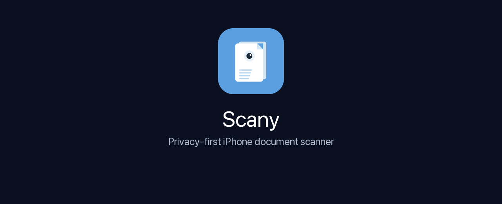
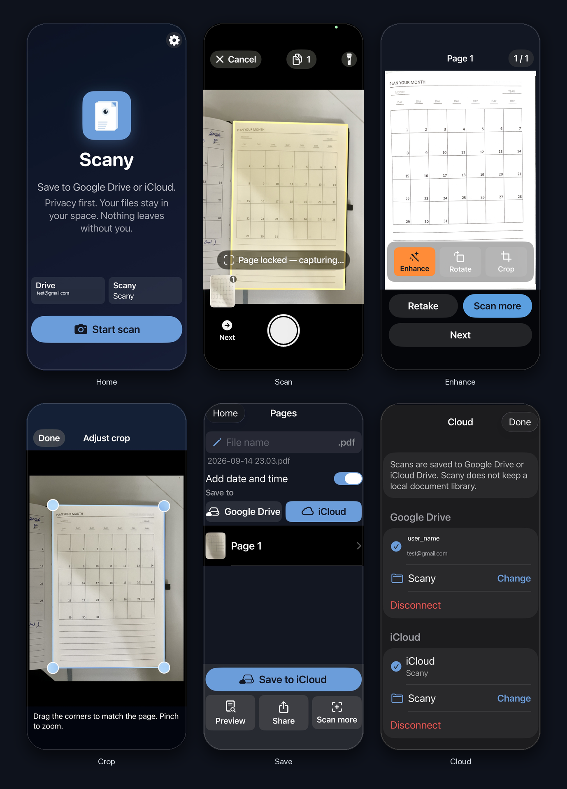

<p align="center">
  
</p>

# Scany

Privacy-first document scanner for iPhone. Point the camera at a page, hold still, and Scany detects the paper in any orientation, waits until the shot is steady, auto-captures, straightens the perspective, and saves a PDF to **your** Google Drive or iCloud. There is no Scany account and no Scany server. Pages are processed on the phone.

Version **1.0** is approved and is being published on the App Store. Product site: [scany.eyesrhythm.com](https://scany.eyesrhythm.com). Privacy: [scany.eyesrhythm.com/privacy](https://scany.eyesrhythm.com/privacy).

<p align="center">
  
</p>

The source in this tree is under the [PolyForm Noncommercial License 1.0.0](https://polyformproject.org/licenses/noncommercial/1.0.0). You may use, modify, and share it for a noncommercial purpose, provided you keep `LICENSE` and the required notice below. Commercial use is not included. Third-party libraries keep their own licenses. See [`THIRD_PARTY_NOTICES.md`](THIRD_PARTY_NOTICES.md).

Required Notice: Copyright Pranay Soni (https://github.com/pranaycv)

This is a custom **AVFoundation + Vision + Core Image** pipeline — not a wrapper around `VNDocumentCameraViewController` — so stabilize-then-auto-capture and continuous multi-page scanning work the way the product requires.

## Requirements

- A Mac with **Xcode 15+** (Xcode 16 recommended)
- **Supported devices:** iPhone 12, 12 mini, 12 Pro, 12 Pro Max, and every newer iPhone
- **Minimum iOS:** **15.0** (the floor for `VNDetectDocumentSegmentationRequest` plus this camera pipeline). iPhone 12 shipped with iOS 14 and can update; install iOS 15 or later.
- A **physical iPhone** is required for camera scanning. The Simulator can launch the app but cannot exercise live page detection.
- An Apple ID / development team for device signing

## Open and run on a real iPhone

1. Clone this repo and open **`Scany.xcodeproj`** in Xcode.  
   (Optional) If you use [XcodeGen](https://github.com/yonaskolb/XcodeGen), `project.yml` can regenerate the project with `xcodegen generate`.
2. Select the **Scany** scheme and your connected iPhone.
3. In the project editor → **Signing & Capabilities**, choose your **Team**. The bundle ID is `com.prnysoni.Scany`.
4. Plug in the iPhone, unlock it, and trust the computer if asked.
5. Press **Run** (⌘R). On first launch, iOS will ask for **Camera** access — allow it.
6. If iOS blocks the developer app: Settings → Privacy & Security → Developer Mode (if prompted), then Settings → General → VPN & Device Management → trust your certificate.

Test scanning on a real iPhone 12 or newer. The Simulator will show the home screen but cannot exercise live page detection.

## Permissions

| Permission | Why |
| --- | --- |
| **Camera** (`NSCameraUsageDescription`) | Live preview, Vision page detection, auto-capture |
| **Motion** (`NSMotionUsageDescription`) | Keep captured pages upright from how you hold the phone |
| Photo Library | **Not required.** Cloud upload is the primary export. Share sheet is a fallback. |

## How to use

1. Tap **Start scan**.
2. Place a page in the frame. A live overlay appears on the detected quad.
3. Hold still. A yellow overlay appears once the page is stable, then Scany captures automatically (shutter sound + haptic) and looks for the next page.
4. The shutter button is optional — use it only if auto-capture does not fire.
5. Thumbnails along the bottom show the session. Long-press a thumbnail to delete.
6. Tap **Done** when finished. On the review screen you can delete / reorder pages, turn on **Auto-enhance all pages**, then **Save to Drive** / **Save to iCloud**. After a successful upload, clear the local page images. System share sheet remains a secondary fallback. There is **no on-device document library**.

Guidance shown in-camera:

- *Position the page in the frame* — no document found
- *Move closer* — page is too small
- *Hold steady…* — detected but still jittering
- *Low light — add more light* — frame is too dark
- *Hold still until it looks sharp* — Laplacian variance is low (motion / misfocus)

After each capture there is a **~1.35s cooldown** so the same page is not captured twice.

Cancel mid-session asks to discard if any pages exist.

## Architecture

```
HomeView → ScanSessionView → ReviewView → Drive / iCloud (share sheet fallback)
                │
                ├─ CameraSession          AVCaptureSession (video + photo)
                ├─ DocumentDetector       VNDetectDocumentSegmentationRequest
                │                         + VNDetectRectanglesRequest fallback
                ├─ QuadStabilizer         jitter / fill / blur / low-light
                ├─ PerspectiveCorrector   CIPerspectiveCorrection
                ├─ OrientationCorrector   Vision text score at 0/90/180/270°
                ├─ ImageEnhancer          CIDocumentEnhancer + contrast + unsharp
                ├─ PageCaptureProcessor   Warp + upright + write JPEG
                ├─ PDFExporter            UIGraphicsPDFRenderer
                └─ CloudManager           Google Drive API v3 + iCloud Drive
```

| Piece | Role |
| --- | --- |
| `Camera/CameraSession.swift` | Back camera, 4K when available, video frames for Vision, stills for capture |
| `Detection/DocumentDetector.swift` | Document quad in Vision normalized coordinates (any paper rotation) |
| `Detection/QuadStabilizer.swift` | Yellow overlay after 5 stable frames, auto-capture after 20 more |
| `Processing/PerspectiveCorrector.swift` | Warp the quad to a rectangle |
| `Processing/OrientationCorrector.swift` | Pick the upright rotation from text; else prefer portrait |
| `Processing/ImageEnhancer.swift` | Document-style enhance applied to **all** pages when enabled once |
| `Processing/PageCaptureProcessor.swift` | Flatten, upright, JPEG write on a background queue |
| `Export/PDFExporter.swift` | Multi-page PDF builder |
| `Cloud/CloudManager.swift` | Connect accounts, remember folder, upload, disconnect |
| `Cloud/GoogleDriveService.swift` | Google Sign-In (SPM) or PKCE + Drive API v3 |
| `Cloud/ICloudDriveService.swift` | iCloud Drive Documents container (`iCloud Drive → Scany`) |
| `Cloud/SimulatedCloudStore.swift` | Sandbox upload when client IDs are still placeholders |
| `UI/Scan/ScanViewModel.swift` | Ephemeral session only — pages are cleared after upload |

Captured pages are JPEGs in a **temporary session folder** only. After a successful cloud upload you can clear them. Scany does not keep a history of past scans.

## Project layout

```
Scany.xcodeproj/          Xcode project + shared scheme
project.yml               XcodeGen spec (optional)
Scany/
  ScanyApp.swift          App entry + Home / Scan / Review routing
  Info.plist              Display name, camera usage, iOS 15 minimum, arm64
  PrivacyInfo.xcprivacy   Privacy manifest
  Assets.xcassets/        App icon + accent
  Cloud/                  Drive + iCloud + Keychain
  Camera/ Detection/ Processing/ Export/ Models/ UI/
```

Display name: **Scany**. iPhone only, **iOS 15.0+**, arm64, SwiftUI, Swift 5.

The project does **not** require iOS 17. SwiftUI APIs that shipped later (`NavigationStack`, `navigationDestination`, two-parameter `onChange`, `scrollContentBackground`, `UIColor(Color)`) are `#available`-gated with iOS 15/16 fallbacks in `UI/Compatibility.swift`. Document detection uses Vision segmentation on iOS 15+, with `VNDetectRectanglesRequest` as the real fallback when no page quad is returned.

## Cloud export (Google Drive + iCloud)

Scans live in a **Google Drive** or **iCloud Drive** folder you choose. Settings (gear on Home, or first export) lets you:

1. **Connect Google Drive** and/or **Connect iCloud**
2. Pick or create a destination folder (remembered for later exports)
3. See account + folder status, **Change** folder, or **Disconnect**

Review’s primary button is **Save to Drive** / **Save to iCloud** (or a chooser if both are connected). Share sheet is secondary.

The iOS OAuth client ID in `CloudConfig.swift` is the public client for the shipped app, bundle ID `com.prnysoni.Scany`. An iOS client has no secret; Google restricts it to that bundle ID. A fork that changes the bundle ID needs its own client. Do not commit a client secret, refresh token, or service-account key.

If `Google.clientID` still starts with `YOUR_`, **Connect Drive** writes files to the app sandbox under `Documents/CloudUploadSimulation/`. iCloud uses the real iCloud account on a device; Simulator falls back to the sandbox if iCloud is signed out.

Privacy policy (App Store + Google consent): https://scany.eyesrhythm.com/privacy

App Store listing copy, privacy answers, and archive steps: `AppStore/LISTING.md`

### 1. Fill in `Scany/Cloud/CloudConfig.swift`

```
Google.clientID = iOS OAuth client ID ending in .apps.googleusercontent.com
```

`isConfigured` is false while the value still starts with `YOUR_`. iCloud needs no client ID.

### 2. Google Cloud Console

1. Create (or pick) a project → **APIs & Services** → enable **Google Drive API**.
2. **Credentials** → **Create credentials** → **OAuth client ID** → application type **iOS**.
3. Bundle ID: `com.prnysoni.Scany`.
4. Copy the client ID into `CloudConfig.Google.clientID`.
5. Add the **reversed client ID** as a URL scheme in `Info.plist` and set `GIDClientID` to the same client ID.
6. OAuth consent screen: add scope `https://www.googleapis.com/auth/drive.file` (files this app creates). `userinfo.email` is used for the Settings label. The app may stay in Testing; users will see Google’s unverified-app warning.

Redirect used by the PKCE fallback: `{reversed-client-id}:/oauth2redirect/google`.

### 3. iCloud Drive

Connect iCloud opens the Files picker. Choose an **iCloud Drive** folder (create one named Scany if you want). No iCloud entitlement is required, so a free personal Apple team can still run on device. PDFs are written into that folder.

### 4. Info.plist URL schemes

| Scheme | Purpose |
| --- | --- |
| `com.googleusercontent.apps.<YOUR_IOS_CLIENT_PREFIX>` | Google Sign-In / PKCE return |
| `scany` | Extra custom scheme |

### 5. Swift packages (Xcode resolves these on open)

| Package | URL | Product | License |
| --- | --- | --- | --- |
| Google Sign-In | https://github.com/google/GoogleSignIn-iOS | `GoogleSignIn` | Apache 2.0 |

Google auth uses the official SDK when the package is linked (`#if canImport`). If it is missing, Drive falls back to **PKCE + `ASWebAuthenticationSession`**. Drive API v3 uploads go through `URLSession`. Google tokens and the remembered folder are stored in the **Keychain**. iCloud uses a security-scoped Files bookmark and `NSFileCoordinator`.

## Notes

- Signing: leave **Automatically manage signing** on and pick your team.
- Camera scanning still needs a physical iPhone. Cloud Settings + simulated upload work in Simulator.
- Torch is available on the scan screen for dim rooms.
- Tap the preview to focus/expose on that point.
- Auto-enhance is a **document-level** switch. New pages captured after you turn it on are enhanced automatically.

## License

Scany’s own code is under the [PolyForm Noncommercial License 1.0.0](LICENSE), the same terms as [EyesRhythm](https://github.com/pranaycv/EyeRhythm). Noncommercial use, modification, and sharing are allowed if you keep `LICENSE` and this notice. Commercial use is not included.

Required Notice: Copyright Pranay Soni (https://github.com/pranaycv)

Questions: [prnysoni@gmail.com](mailto:prnysoni@gmail.com). Security reports go to the same address. See [`SECURITY.md`](SECURITY.md).

